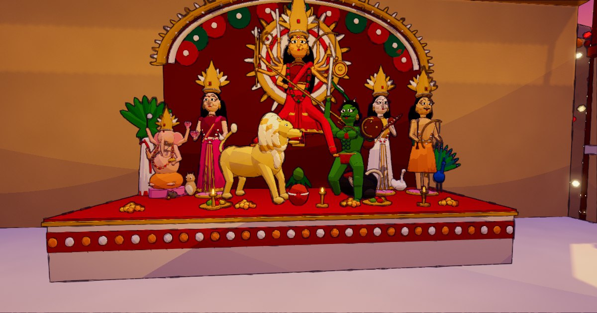
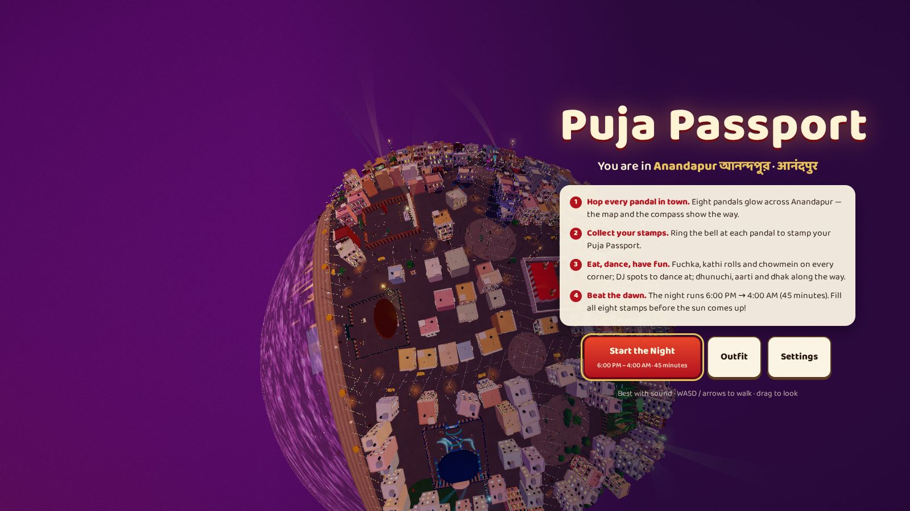
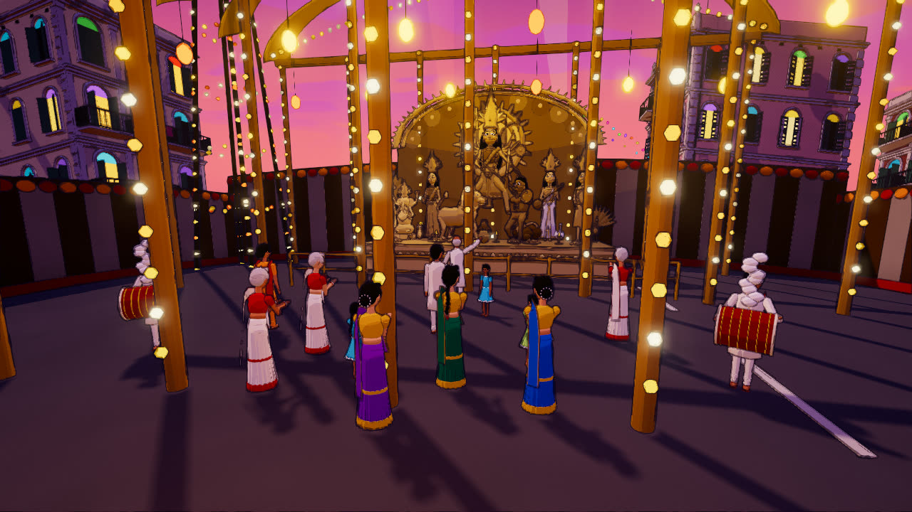
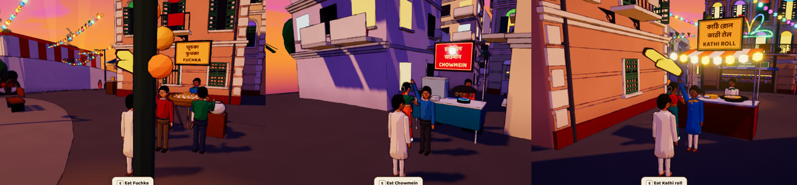
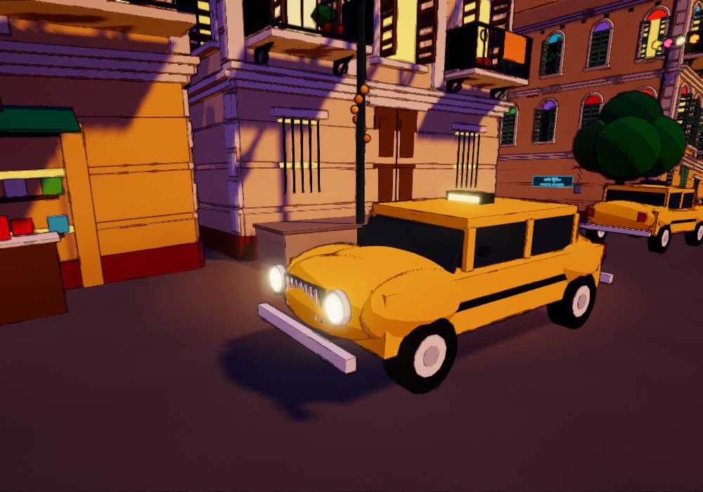
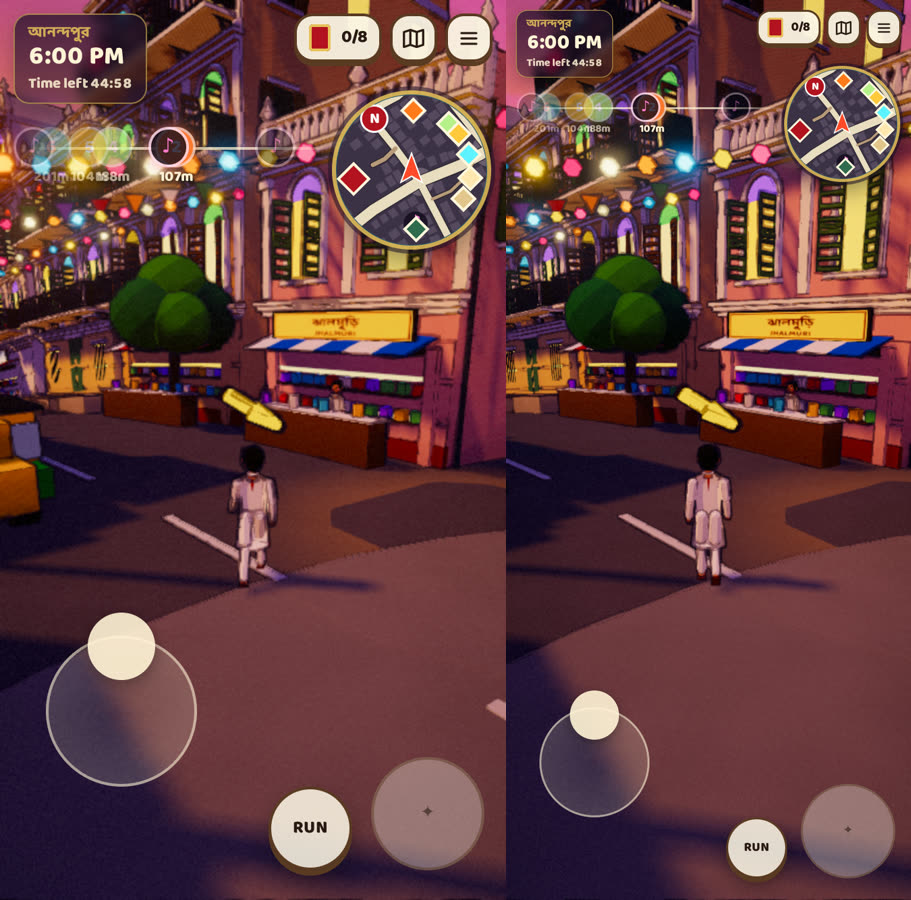
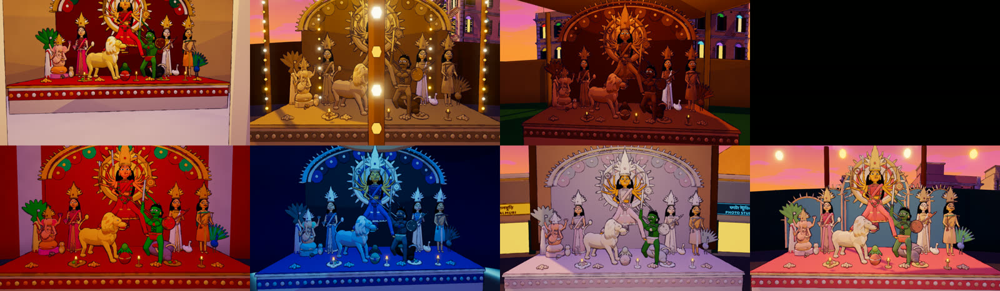

## 🎮 The game is live at **[puja-passport.pages.dev](https://puja-passport.pages.dev)**

# Puja Passport · পূজা পাসপোর্ট · पूजा पासपोर्ट

*You are in Anandapur. Hop every pandal, eat, dance, and fill your passport before dawn.*

A cozy 3D Durga Puja pandal-hopping game for the browser, on desktop, phone and tablet. It's
6:00 PM on Ashtami night in the fictional Bengali city of **Anandapur**. You have until 4:00 AM
(45 real minutes) to visit all ten pandals and ring each one's bell for a stamp in your
**Puja Passport**. On the way you can eat fuchka, kathi rolls and chowmein, dance at the DJ
spots, join the dhunuchi naach, and wander the old para lanes. Fill all ten stamps and the
night ends with a sunrise at the river ghat.



| | |
|---|---|
|  |  |
|  |  |
|  |  |



More in [docs/screenshots/gallery](docs/screenshots/gallery).

## Quick start

Requires **Node.js 22.19+ / 24.11+** (developed on Node 24.18) and npm.

```bash
npm install          # install dependencies
npm run dev          # dev server with hot reload → http://localhost:5173
npm run build        # type-check (tsc) + production build into dist/ (includes your own songs, see below)
npm run build:public # the same, but WITHOUT any songs from public/assets/audio/musics. Use this to publish
npm run preview      # serve the production build → http://localhost:4173
npm test             # unit tests (Vitest)
npm run test:e2e     # browser end-to-end tests (Playwright; builds and serves automatically)
```

For `npm run test:e2e` on a fresh machine, install a browser first: `npx playwright install chromium`.
To publish the game, see **[docs/DEPLOY.md](docs/DEPLOY.md)**.

### Controls

| Desktop | Touch | Action |
|---|---|---|
| **W A S D** / arrow keys | joystick (lower-left) | Walk. On desktop hold **Shift** to jog; on touch push the stick all the way or toggle **RUN** |
| mouse drag · wheel | swipe · pinch | Orbit and zoom the camera |
| **E** | big round action button | Interact: ring a bell, eat, dance, sit, offer pranam, talk, take a selfie… |
| **P** · **M** | HUD buttons | Puja Passport · city map |
| **C** | n/a | Photo mode |
| **Esc** | ☰ | Pause and settings (the clock stops while paused) |
| **K** | n/a | Skip the rhythm game (accessibility) |

### URL options (development and testing)

| Parameter | Effect |
|---|---|
| `?debug=1` | Exposes `window.__anandapur` (teleport, completePandal, getState, setElapsed, renderInfo, …) for the test suite |
| `?autostart=1` | Clicks the first title button automatically. Browsers still block audio until a real click |
| `?seed=1931` | Seed for procedural prop placement. The city layout itself is hand-authored |

## What's in the game

- **A timed festival night.** It runs 6:00 PM → 4:00 AM over 45 minutes and pauses whenever a menu is open or the tab is hidden. If time runs out, the night ends gracefully; you can retry or go sightseeing without a clock.
- **Ten pandals, each with its own theme and idol tradition:** *Rajbarir Pujo* (a zamindar mansion, classic *sabeki* Kumartuli), *Alor Thikana* (lamps and light arches, an all-gold protima), *Matir Taan* (rural Bengal, unpainted terracotta), *Aranyer Ahoban* (an enchanted forest, jute-and-leaf eco), *Dhaker Taale* (the dhak, patachitra colours), *Neel Swapno* (an ocean dream, sea-blue and pearl), *Smritir Shohor* (old Kolkata, silver *daker saaj*), *Nodir Opare* (out on the river, reached by a footbridge; pastel *alada chala*), *Nakshatralok* (a realm of stars, indigo and silver) and *Debaloy* (a temple pandal, a grand red-and-gold image). Ring each pandal's entrance bell for its stamp — no prerequisite — and enjoy its activity if you like. Chevrons on the ground guide you to the entrance of any pandal you haven't visited yet.
- **Landmarks:** bronze statues of Netaji Subhas Chandra Bose (two), Swami Vivekananda and Rabindranath Tagore, garlanded in marigolds, and an aat-chala Shiva mandir with its pukur.
- **The full ekchala:** Durga with ten arms bearing weapons, her foot on the lion, the trishul through Mahishasura; Lakshmi with lotus and owl, Saraswati with veena and swan, Ganesh with Kola Bou and the mouse, Kartik with bow and peacock.
- **Things to do on the way:** eat at fuchka, chowmein, kathi-roll, jhalmuri, cha and mishti stalls; dance at 12 DJ spots; sit on benches; offer pranam; join the dhunuchi naach; take selfies; talk to people; find hidden secrets.
- **A living city:** about 300 people, including shopkeepers behind every open shop, vendors with queues, dhakis, and dancers. Taxis, autos and a tram run on rails with turning wheels.
- **Navigation:** a GTA-style rotating minimap, a compass ribbon with pandal markers and ♪ DJ markers, and an illustrated city map.
- **Languages:** pandal and food-stall names appear in Bengali, then Devanagari, then English, all in the Baloo font family at the same size.
- **Phone and tablet support:** portrait layout, floating joystick, swipe to look, pinch to zoom, safe-area insets, and a Medium graphics default.
- **Audio:** the dhak (a recording; see credits) fades out within about 30 m of each pandal. DJ music plays fully within 4 m and falls silent by 15 m, and while you're at a DJ spot everything else ducks. Everything else is synthesised in WebAudio.

### Your own DJ songs

Drop audio files into `public/assets/audio/musics/`. Before every `dev`/`build`, `scripts/prepare-music.mjs`
converts them into loudness-matched MP3s (with ffmpeg if available), and the DJ boxes play them at random.
That folder is git-ignored. **`npm run build:public` never ships these songs.** It writes an empty playlist,
and the DJ boxes fall back to the game's own generated festival tracks.

## Project layout

```
src/
  core/        Game loop, phases, input, debug hook
  rendering/   Renderer, toon materials + tiny-planet bend, post FX, sky, lighting
  world/       City builder, roads, collision, batching, festivities (traffic, light boards)
    props/     Bengali buildings (fronts and side façades), street furniture, food stalls, signboards
    pandals/   The 8 pandal builders, gates, the protima (protima.ts) with its 8 styles
  player/      Character model and animation, controller, player actions (eat, dance, sit, pranam…)
  camera/      Third-person orbit camera
  npc/         Living city (NPCs, stalls, shopkeepers) and DJ boxes
  gameplay/    Progress, SimClock (the timed night), pandal controller, atmosphere
  ui/          HUD, minimap, touch controls, passport, map, menus, stamps, styles
  audio/       WebAudio engine, DJ music
  data/        Pandals, layout, dhak cuts
  save/        Versioned save store
tests/unit     Vitest tests (pure logic)
tests/e2e      Playwright tests (desktop and phone portrait)
docs/          Research, design, architecture, progress log, deploy guide
tools/         Dev scripts (screenshots, perf probes, audio checks)
```

## Documentation

- [Deploying (Cloudflare Pages, Netlify, GitHub Pages)](docs/DEPLOY.md)
- [Testing & performance](docs/testing-and-performance.md)
- [Known issues & future work](docs/known-issues.md)
- [Session report, 14 Oct 2026](docs/session-report-2026-10-14.md)
- [Progress log](docs/PROGRESS.md)
- [Game design document](docs/game-design.md)
- [Technical architecture](docs/technical-architecture.md)
- [Durga Puja research](docs/durga-puja-research.md)

## Credits and licences

- Code, procedural models, SVG stamps and synthesised audio are original to this project.
- Dhak recording: Mamta Jagdish Dhody, CC BY-SA 4.0; crowd recording "Crowd Talking 003", CC0 (see `public/assets/audio/CREDITS.txt`).
- Fonts: **Baloo Da 2** and **Baloo 2** by Ek Type, SIL Open Font License 1.1 (via @fontsource). They are self-hosted.
- Engine: [three.js](https://threejs.org) (MIT).

*Anandapur and its pandals are fictional. Durga Puja is a living tradition inscribed by UNESCO
in 2021; this game is a loving tribute, not a depiction of real worship.*
